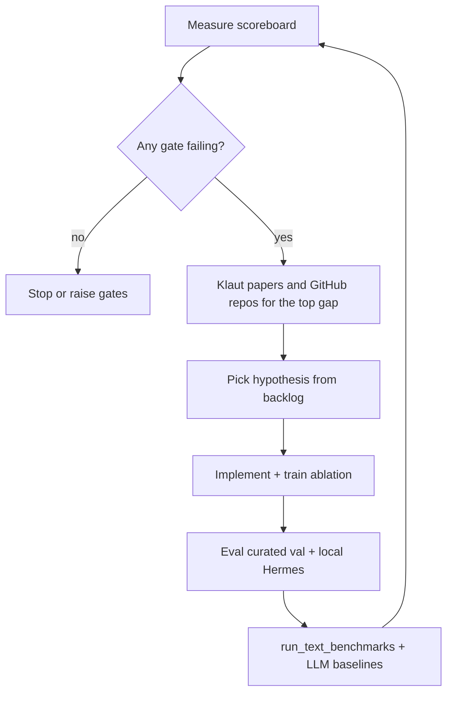

# Auto-research loop (Klaut + benchmarks)

**Date:** 2026-10-05

Goal: iterate on the 1D trace NCA (and later heads) until it **beats small local LLMs on every scored benchmark gate**, using literature-backed hypotheses. Teacher / distillation is capped at **9B parameters** (`qwen3.5:9b` on engine).

This is a **process** document. The scoreboard lives on the external SSD; gates are in [`config/benchmark_gates.json`](../config/benchmark_gates.json).

## Stop condition

Stop when every gate in `benchmark_gates.json` either:

- **passes** (NCA metric ≥ min and beats listed baselines), or
- remains **blocked** only because harness code is missing (τ2, AppWorld) — and those blockers are tracked explicitly.

Do not claim victory on BFCL/NESTFUL until the same scoring scripts used for the NCA are run for **Qwen2.5-1.5B-Instruct** (and optionally `qwen3.5:9b`) on identical inputs.

## Current scoreboard snapshot (2026-10-05)

| Metric | NCA (best) | Baseline to beat |
| --- | ---: | ---: |
| Curated val top-1 | 65.2% (step 26k mix13) | flat 60.7% ✓ |
| Local Hermes top-1 | 40.1% | always-terminal **49.5%** ✗, Qwen2.5-1.5B **6.3%** ✓ |
| BFCL AST | not re-run on latest ckpt | set after paired LLM run |
| τ2 / AppWorld | blocked (packages) | — |

Local Qwen numbers: [`results/local_next_tool_qwen25_1_5b.json`](file:///Volumes/Extreme%20SSD/nca_research/results/local_next_tool_qwen25_1_5b.json) on the SSD.

### 3-day mission status (live)

| Item | Status |
| --- | --- |
| Deadline | 2026-10-08T13:11:54Z |
| Branch | `cursor/auto-research-klaut-1754` (ahead of origin — push via `./scripts/push_branch.sh` in Terminal) |
| Queue | H6 150k `long_range` → `baseline` → `flat` (tmux `nca-daemon`; SSD writes OK) |
| `long_range` progress | ≥25k / 150k; val_top1 ≈ 0.615 @25k (peak 0.635 @10k) vs always-terminal 0.543 |
| Specialist compile | tmux `nca-compile`; python ≈23.7k rows; scanning swe-rebench; ts/shell sparse |
| Engine Ollama | local up but **embed-only** (`nomic-embed-text`) — no generative distill until 9B present; Klaut reachable |
| HF top-4 (provisional) | A=`textnca` EXP-20261003-001 (0.652); B=`flat` EXP-20261005-002 (0.630); C/D pending |
| Ops | `python scripts/status_lean.py`; caffeinate in `nca-caffeine`; [mac-worker-prep.md](mac-worker-prep.md), [huggingface-distribution.md](huggingface-distribution.md) |
| PR | Agent sandbox: DNS/`gh` keychain blocked. Compare: https://github.com/cap-jmk-real/nca_research/compare/main...cursor/auto-research-klaut-1754?expand=1 |

Prior 150k `long_range` reached step 150k in-memory but **failed saving** the checkpoint when macOS blocked SSD writes; rerun is the source of truth for SI once it completes and saves.

## Long training (do not skip)

Local update / iterative policies need **long** AdamW budgets before architecture
comparisons are meaningful. Recent Sudoku / combinatorial-reasoning work trains
transformers for large trace corpora and many epochs (or many internal reasoning
steps) before accuracy plateaus — e.g. Giannoulis et al., NeurIPS 2025
([arXiv:2509.22023](https://arxiv.org/abs/2509.22023); Sudoku trial-and-error on
a vanilla GPT-2), and follow-on Sudoku world-model analyses trained for multiple
epochs on millions of traces (Google TPU runs in that line). The same caution
applies to the 1D NCA: a few thousand steps can look flat while 150k separates
cellular from linear.

| Budget | Use |
| --- | --- |
| ≤ 8k | Plumbing / compile / shape checks only |
| 20k–50k | Early curve shape — **not** a verdict |
| **≥ 150k** | Default equal-budget ablations (matches mix13) |
| Resume mix / FineEnvs | Prefer continuation over `--fresh` short jobs |

Daemon env: `NCA_HYP_STEPS=150000` (default). The 3-day runner must not demote
hypotheses to smoke budgets to “fit more experiments.” Prefer fewer, fully
trained runs.

## Distillation rules (≤ 9B)

| Allowed | Forbidden |
| --- | --- |
| Verifier-filtered multi-harness **labels** (FineEnvs common slice) | KL / hidden-state match into `TextNCA` |
| Teacher **rewrites tool result text** in observations | Pouring 27B teacher completions into respond-heavy mix |
| Pseudo-labels on high-entropy rows only | Training the cellular rule to mimic 9B logits |
| 9B as τ2 **user simulator** or reply filler in a hybrid | Second generative policy the NCA copies |

See [multi-harness-and-message-passing.md](multi-harness-and-message-passing.md) for why 27B SFT underperformed multi-harness RL on LFM2.5.

## Klaut research gateway

| | |
| --- | --- |
| Base URL | `http://192.168.10.29:30487` (engine NodePort; see [literature.md](literature.md)) |
| Search | `POST /v1/research/papers/search` |
| Synthesis | `POST /v1/research/reports` |
| CLI | `python scripts/klaut_gateway.py search "query"` |
| Cache | `/Volumes/Extreme SSD/nca_research/results/cache/klaut/` |

Synthesis uses **`qwen3.5:9b`** on engine — within the distillation cap, but used here for **literature**, not as NCA teacher weights.

When the gateway is unreachable (e.g. cloud agent off-LAN), the client returns the newest cached search/report. Hypothesis intake does not treat that fallback as the answer to a new query.

### Hypothesis intake

The intake is not a claim that the search has converged. Besides the gate queries it also searches two adjacent fields: attention inside a neural cellular automaton, and TextNCA’s hierarchical local attention. A paper already cited in the literature notes can still become a backlog row when the mechanism is not already an experiment. Image-growing reproductions stay rejected. A transfer has to name a runnable harness.

The objective is the best accuracy the runnable harnesses record: curated val next-tool, local Hermes, BFCL AST, BFCL irrelevance, and Nestful full sequence. A curated-val gain alone is not success while another of those is failing or unscored. τ2 airline, τ2 retail, and AppWorld stay blocked. The tick does not mark them passed and does not invent scores. `config/benchmark_gates.json` changes only when the same harness has real NCA and LLM numbers.

A hit is rejected when it is off-domain, including mammography segmentation, genetics drift, a survey with no method we can implement, and an image-only NCA demo. A missing code URL is not a reject by itself. A GitHub repository counts as code. A backlog row is added when the record describes a concrete change for text NCA or next-tool prediction that we can implement and score on a named runnable harness (curated val, local Hermes, BFCL AST, BFCL irrelevance, Nestful), the change is not already listed (including H6, H20, and H_long_range_prod), and it does not require stopping a 150k run. The query, hit id, and reason go to `results/auto_research/klaut_intake.json` on the SSD. Ids already judged under the current rule are not reported as new. The intake note lists the failing harnesses. A curated-val-only gain is not a pass while those harnesses fail. A full Klaut report is not requested unless a hit is a new architecture family with code.

`--klaut-search` writes the scoreboard and that intake note. It does not start or stop training.

## Loop (one cycle)



### Commands (M1 + SSD)

```bash
source scripts/env.sh
./scripts/check_setup.sh
./scripts/start_auto_research.sh --with-compile

# Manual cycle (if not using the daemon)
python scripts/auto_research.py --klaut-search
python -m nca_text.hypotheses --steps 150000 --only long_range baseline flat
python scripts/run_text_benchmarks.py
python scripts/score_local_next_tool.py   # Qwen2.5-1.5B baseline

# Push from Terminal after gh auth (HTTPS)
./scripts/push_branch.sh
```

First-time Mac: `./install.sh --deps` — see [mac-worker-prep.md](mac-worker-prep.md).

Cycle JSON: `/Volumes/Extreme SSD/nca_research/results/auto_research/latest.json`.

## Efficiency (tokens + compute)

Keep agent monitoring and LM calls thin — see [efficiency.md](efficiency.md).
Supervise every **12h**: run `python scripts/status_lean.py`, reply with that
block only. Distill/eval teachers answer with `ROUTE:` / `TOOL:` only
(`num_predict` ≤ 24). LLM baselines share the NCA 160-char obs cap.
TextNCA stays a classifier (not a generator).

## Commit cadence

Push often on the working branch (`cursor/auto-research-klaut-1754` for the 3-day run):

- After each completed train / SI register / dataset milestone.
- On every supervision tick if the tree is dirty.
- Prefer small conventional commits (`feat:`, `docs:`, `fix:`) over end-of-day dumps.

The daemon may auto-commit SI + doc updates after successful queue items when `NCA_AUTO_COMMIT=1` (default on).

## Paper / supporting information

Every completed train or baseline that might appear in a manuscript must land in
[`paper/si/experiments/`](../paper/si/experiments/) as an `EXP-*` record
([schema](../paper/si/experiment_schema.json)). Tables S1–S3 are generated by:

```bash
python scripts/record_experiment.py backfill      # once / after new SSD metrics
python scripts/record_experiment.py build-tables
```

See [paper/README.md](../paper/README.md). The daemon registers hypotheses
summaries automatically after each long train.

### Agent skill

Use the project skill **nca-auto-research** (`.cursor/skills/nca-auto-research/SKILL.md`) in Cursor so each session:

1. Runs `auto_research.py` first.
2. Implements the top **suggested_hypotheses** entry not yet tried.
3. Updates gates only with paired NCA + LLM numbers.
4. Appends a one-line result to `docs/hypotheses-backlog.md` under the hypothesis.

## Hypothesis generation

- **Backlog:** [hypotheses-backlog.md](hypotheses-backlog.md) (30 items, prioritized).
- **Measured ablations:** [hypothesis-tests.md](hypothesis-tests.md).
- **Architecture program:** [research-design.md](research-design.md).

New hypotheses should name: claim, gate, Klaut query, estimated cost, distillation interaction (if any).

## Benchmarks in scope

From [benchmarks.md](benchmarks.md), parallel text suite:

1. BFCL non-live AST + irrelevance  
2. NESTFUL `data_v2`  
3. τ2 airline + retail (text, one trial)  
4. AppWorld dev → test_normal  

SWE-bench Lite is **out of band** until patch head exists. Vision benchmarks wait on research-design step 1.

## Raising the bar

After the NCA beats Qwen2.5-1.5B on all **wired** gates:

1. Add **`qwen3.5:9b`** as a second local baseline (same prompts, engine Ollama).
2. Tighten mins in `benchmark_gates.json` toward published small-model leaderboard slices.
3. Wire τ2 and AppWorld blockers; add gates for SWE-lite @5 instances.

## Specialist coder stack

Python → TypeScript → Shell specialists + orchestrator, distilled from ≤9B teachers,
evaluated on open harnesses: [specialist-coder-stack.md](specialist-coder-stack.md),
`config/specialists.json`.

```bash
python scripts/compile_specialist_datasets.py --langs python typescript
python scripts/distill_specialist.py --lang python --limit 128   # needs engine
python scripts/eval_specialist_harness.py --lang python --harness LiveCodeBench
```

## Related commits

- Message-passing ablations: `nca_text/hypotheses.py`, [hypothesis-tests.md](hypothesis-tests.md).
- Benchmark scorer stub: `scripts/run_text_benchmarks.py`.
- Specialist stack: `scripts/compile_specialist_datasets.py`, `distill_specialist.py`, `eval_specialist_harness.py`.
